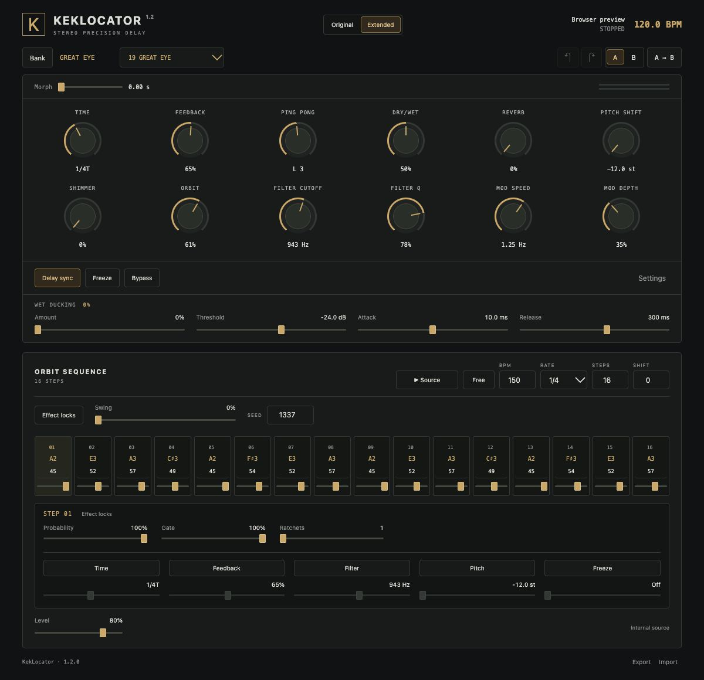

# KekLocator

A stereo delay with a native Rust audio engine, an embedded WebAssembly editor,
and a tempo-synced 16-step sequencer. Available as **VST3 and CLAP for Windows
x64**, and **VST3, AU and CLAP for macOS Apple Silicon and Intel**.

KekLocator is the renamed Echolocator Rust software port. Its **Original** mode
uses a static Rust translation of Erica Synths Echolocator firmware 1.05.
**Extended** adds performance and sequencing tools. This is an unofficial project
and is not affiliated with Erica Synths.



## Download and install

Get the packages from [GitHub Releases](https://github.com/fushugaku/KekLocator/releases).

- **Windows:** extract the Windows x64 ZIP and run `Install.ps1`, or copy the
  included VST3 bundle and CLAP file to your DAW's plug-in folders. The editor
  requires the Microsoft Edge WebView2 Runtime. See [Windows instructions](plugins/windows-README.txt).
- **macOS:** open the universal PKG and choose VST3, AU and/or CLAP. Installation
  is for the current user. The local build uses ad hoc plug-in signatures; the
  installer has no Developer ID signature or Apple notarization.

Insert **KekLocator** as an audio effect. Enable **Source** and **Host**, then
press Play in the DAW to hear the internal sequencer. **Free** uses its own BPM.
See [the plug-in guide](PLUGINS.md) for all controls and upgrade instructions.

## Features

- Tape/BBD modes, eight taps, Orbit, Ping Pong, filtering and routing,
  compression, reverb, pitch/frequency shift, Shimmer A/B, Dub, Freeze and Dry/Wet.
- Original mode is the default. The extension settings are preserved while
  Original bypasses their effect on the audio.
- Host tempo, transport and song-position sync; independent delay and sequencer
  divisions; 1–16 steps, note and velocity editing, transpose and free tempo.
- Extended swing, probability, gate, ratchets, repeatable seed, and per-step
  Time, Feedback, Filter, Pitch and Freeze locks.
- Wet ducking, 51 factory sounds, separate sound and pattern banks, search,
  favorites, sound A/B, Undo/Redo, and preset morphing up to 10 seconds.
- Native processing at 44.1, 48, 96 and 192 kHz. The original DSP runs internally
  at 48 kHz; the DAW adapter resamples and reports its latency.
- An offline embedded editor. Audio processing does not require a web server.

The full browser instrument additionally offers audio-file playback, live input,
recording, WAV export, Web MIDI, pedal actions, Magic, and original `.elb` bank
import/export. Plug-in-only extensions live in the separate performance editor.

## Build

Prerequisites: Rust through rustup, Python 3, Git and CMake. Native builds also
need Apple Command Line Tools on macOS or Visual Studio 2022 C++ build tools
and a Windows SDK on Windows. Dependencies are fetched on the first build.

```sh
# Browser instrument and performance-editor preview
./run.sh
# Open http://127.0.0.1:4173/ or /plugin.html

# macOS universal plug-ins and installer
./tools/build-plugins.sh
python3 tools/build-pkg.py
```

```powershell
# Windows x64 plug-ins and portable installation package
./tools/build-plugins.ps1
./tools/verify-windows.ps1
```

To build only the Rust workspace, first run `python3 tools/prepare-firmware.py`,
then `cargo build --release --workspace`. Manufacturer binaries are downloaded
from their original URLs and verified against pinned SHA-256 hashes; they are
not stored in this Git repository. SDK commits are pinned in
[plugins/SOURCES.json](plugins/SOURCES.json). See [PORTING.md](PORTING.md) for
firmware provenance and the translation process.

The browser build requires localhost or HTTPS for AudioWorklet, MIDI and live
input. Files and presets remain on the device. The server binds to 127.0.0.1.
A different port can be selected with `./run.sh --port 4174`.

## Verification and limits

```sh
./tools/verify.sh                 # Rust tests and native/WASM comparison
./tools/verify-original.sh        # independent ARM firmware oracle
node tools/verify-original-wasm.mjs
./tools/verify-plugins.sh         # macOS native format tests and VST3 validator
```

The firmware baseline passed 187 audio scenarios and 46,761,600 channel samples
with zero digital differences. This establishes agreement at the tested digital
boundary, not with the physical pedal's converters and analog circuitry.
[The audit](AUDIT.md) records the test boundary and remaining differences.
Windows CI builds and tests the actual native VST3 and CLAP binaries, including
host transport, timestamped automation and legacy state loading.

The translation does not emulate the entire hardware board. Single-preset
`.elp` files, firmware Magic names and a hardware-style factory reset are not
implemented. Magic uses a different random generator. See [NOTICE.md](NOTICE.md)
for attribution and third-party source information.
